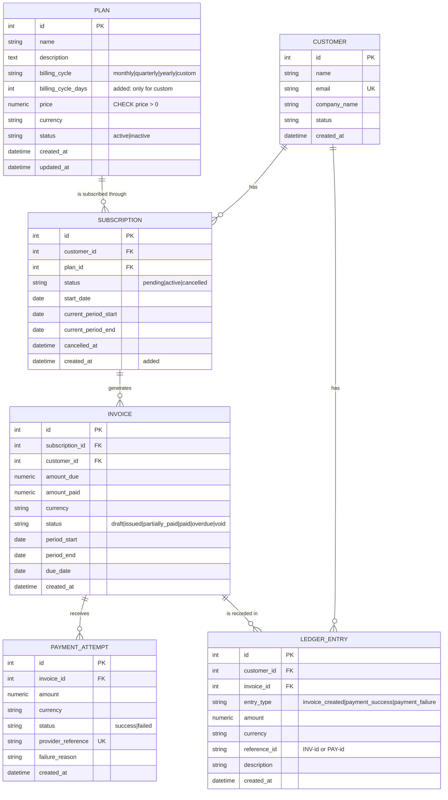
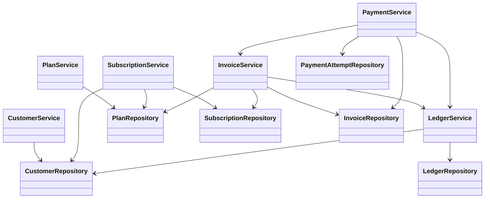

# SubLedger - Low-Level Design

SubLedger is a simplified SaaS billing backend: **plans, customers, subscriptions, invoices, payments and an append-only ledger**.
This document is the LLD that the code in `app/` follows.

## 1. Layered architecture

```
HTTP request
   |
   v
routes/        parse + validate input (schemas), call ONE service method, return a response model
   |
   v
services/      business rules and workflows (the only place rules live)
   |
   v
repositories/  all database reads/writes (SQLAlchemy queries), no business rules
   |
   v
models/        SQLAlchemy tables, relationships, DB constraints
```

| Layer | Folder | Responsibility |
|-------|--------|----------------|
| Config | `app/config.py` | Settings from environment variables / `.env` |
| DB | `app/db.py` | Engine, session factory, `Base`, per-request session (unit of work) |
| Models | `app/models/` | Tables, relationships, constraints |
| Schemas | `app/schemas/` | Pydantic request/response models and input validation |
| Repositories | `app/repositories/` | Persistence only |
| Services | `app/services/` | Business rules and workflows |
| Routes | `app/routes/` | HTTP layer only |
| Wiring | `app/dependencies.py` | Builds repositories and services and injects them with `Depends` |
| Errors | `app/exceptions.py`, `app/main.py` | Domain errors mapped to HTTP codes (404 / 409 / 400) |

### Dependency direction and injection
Routes depend on services, services depend on repositories, repositories depend on the DB session. No class creates its own
collaborators; `app/dependencies.py` builds them and FastAPI injects them. Every object in one request shares the same session.
Because services receive their repositories in the constructor, they can be unit tested with fakes
(see `tests/test_payment_service_unit.py`).

### Transactions (unit of work per request)
Repositories only `add` and `flush`; they never commit. `get_db` (in `app/db.py`) commits once when the request succeeds and
rolls back if any exception escapes. So every API call is atomic: recording a payment writes the payment attempt, the invoice
update and the ledger entry together, or none of them.

## 2. Entity Relationship Diagram



### Schema table (all columns)

**plans**: `id` PK, `name`, `description`, `billing_cycle`, `billing_cycle_days`, `price` (CHECK > 0), `currency`, `status`, `created_at`, `updated_at`

**customers**: `id` PK, `name`, `email` (UNIQUE), `company_name`, `status`, `created_at`

**subscriptions**: `id` PK, `customer_id` FK, `plan_id` FK, `status`, `start_date`, `current_period_start`, `current_period_end`, `cancelled_at`, `created_at`;
partial UNIQUE index on (`customer_id`, `plan_id`) where `status = 'active'`

**invoices**: `id` PK, `subscription_id` FK, `customer_id` FK, `amount_due`, `amount_paid`, `currency`, `status`, `period_start`, `period_end`, `due_date`, `created_at`;
CHECKs `amount_due >= 0`, `amount_paid >= 0`, `amount_paid <= amount_due`; UNIQUE (`subscription_id`, `period_start`, `period_end`)

**payment_attempts**: `id` PK, `invoice_id` FK, `amount` (CHECK > 0), `currency`, `status`, `provider_reference` (UNIQUE, nullable), `failure_reason`, `created_at`

**ledger_entries**: `id` PK, `customer_id` FK, `invoice_id` FK, `entry_type`, `amount`, `currency`, `reference_id`, `description`, `created_at`

### Fields added beyond the minimum model (and why)
| Field / constraint | Why |
|--------------------|-----|
| `plans.billing_cycle_days` | The brief allows a `custom` billing cycle "if explained". Custom plans need a length in days. |
| `subscriptions.created_at` | Standard audit field. |
| Unique `invoices(subscription_id, period_start, period_end)` | Prevents billing the same period twice (retries, double clicks). |
| Unique `payment_attempts.provider_reference` | Prevents recording the same gateway transaction twice. |
| `status` values `pending` on subscriptions | Needed for the "create then activate" lifecycle in the requirements. |

Money is stored as `NUMERIC(12,2)` and handled as `Decimal`, never `float`. In JSON responses amounts are strings (e.g. `"499.00"`) so no precision is lost.

## 3. Service responsibility table

| Service | Owns (business logic) | Should NOT do |
|---------|-----------------------|---------------|
| `PlanService` | Price > 0, valid billing cycle (custom needs `billing_cycle_days`), create / update / deactivate plans | Touch subscriptions or invoices; write SQL |
| `CustomerService` | Create customers, email uniqueness (case-insensitive), fetch customer profile | Create subscriptions; know about billing |
| `SubscriptionService` | Create / activate / cancel subscriptions, plan must be active, no duplicate active subscription, compute billing period | Generate invoices; take payments |
| `InvoiceService` | Generate invoices for active subscriptions, `amount_due` from plan price at generation time, one invoice per period, move invoice status after a successful payment | Validate payment amounts; write ledger rows directly |
| `PaymentService` | Record payment attempts, validate amount / currency / invoice state, no overpayment, failed payments never touch `amount_paid`, trigger invoice update and ledger entry | Compute invoice status itself (delegates to `InvoiceService`); write SQL |
| `LedgerService` | Create append-only ledger entries, build `reference_id`, fetch a customer's ledger history | Update or delete entries; decide whether a payment is valid |

Deviation from the skeleton in the brief: `PaymentService` also receives `InvoiceService`, because the brief's ownership table says
`InvoiceService` updates the invoice status after a payment, and we keep that rule in one place.

## 4. Repository responsibility table

| Repository | Entities it reads / writes | Common methods | Should NOT do |
|------------|---------------------------|----------------|---------------|
| `PlanRepository` | `Plan` | `add`, `get`, `save`, `list(status, skip, limit)` | Validate price or status rules |
| `CustomerRepository` | `Customer` | `add`, `get`, `save`, `get_by_email`, `list` | Decide whether an email is acceptable |
| `SubscriptionRepository` | `Subscription` | `add`, `get`, `save`, `get_active_for_customer_and_plan`, `list(customer_id, status)` | Decide whether a duplicate is allowed |
| `InvoiceRepository` | `Invoice` | `add`, `get`, `save`, `get_by_subscription_and_period` | Calculate amounts or statuses |
| `PaymentAttemptRepository` | `PaymentAttempt` | `add`, `get`, `get_by_provider_reference`, `list_by_invoice` | Validate payment amounts |
| `LedgerRepository` | `LedgerEntry` | `add`, `list_by_customer`, `list_by_reference` (**no update, no delete**) | Anything that modifies existing entries |

All repositories share `BaseRepository` (`add`, `get`, `save`) except `LedgerRepository`, which intentionally exposes less.

## 5. Business-rule ownership

| # | Rule | Schema | Service | Repository | Model / DB constraint |
|---|------|--------|---------|------------|-----------------------|
| 1 | Plan price must be > 0 | `PlanCreate.price` `gt=0` | `PlanService._validate_price` | - | `CHECK price > 0` |
| 2 | Customer email must be unique | `EmailStr` format | `CustomerService.create_customer` (lower-cases and checks) | `CustomerRepository.get_by_email` | `UNIQUE customers.email` |
| 3 | No subscription to an inactive plan | - | `SubscriptionService._get_active_plan` | `PlanRepository.get` | - |
| 4 | No two active subscriptions to the same plan | - | `SubscriptionService._ensure_no_active_duplicate` | `SubscriptionRepository.get_active_for_customer_and_plan` | Partial `UNIQUE (customer_id, plan_id) WHERE status='active'` |
| 5 | Invoice `amount_due` = plan price at generation time | - | `InvoiceService.generate_invoice` (copies `plan.price`) | `PlanRepository.get` | `CHECK amount_due >= 0` |
| 6 | Successful payment cannot exceed unpaid amount | `amount` `gt=0` | `PaymentService.record_payment` | - | `CHECK amount_paid <= amount_due` (backstop) |
| 7 | Fully paid -> `paid`, partial -> `partially_paid` | - | `InvoiceService.apply_successful_payment` | `InvoiceRepository.save` | - |
| 8 | Failed payment does not increase `amount_paid` | - | `PaymentService.record_payment` (only calls `apply_successful_payment` on success) | - | - |
| 9 | Ledger is append-only and traceable via `reference_id` | `LedgerEntryOut` is read-only | `LedgerService` (only creates; builds `INV-<id>` / `PAY-<id>`) | `LedgerRepository` (no update/delete methods) | ORM `before_update` / `before_delete` guard raises `LedgerImmutableError` |
| 10 | Only active subscriptions can be invoiced (added) | - | `InvoiceService.generate_invoice` | - | - |
| 11 | One invoice per subscription per period (added) | - | `InvoiceService.generate_invoice` | `InvoiceRepository.get_by_subscription_and_period` | `UNIQUE (subscription_id, period_start, period_end)` |
| 12 | Payment currency must match the invoice (added) | - | `PaymentService.record_payment` | - | - |
| 13 | Only issued / partially paid / overdue invoices accept payments (added) | - | `PaymentService.record_payment` | - | - |
| 14 | A `provider_reference` can be recorded only once (added) | - | `PaymentService.record_payment` | `PaymentAttemptRepository.get_by_provider_reference` | `UNIQUE provider_reference` |

Service checks give friendly errors; the database constraints are the safety net if two requests race.

## 6. Design pattern used and why

**Repository Pattern + Service Layer** (with constructor-based dependency injection).

* **Repository pattern**: every database query lives in a repository class. Services never write SQL, so the storage can change
  (SQLite in tests, PostgreSQL in Docker) without touching business rules.
* **Service layer**: every business rule and workflow lives in a service. Routes stay thin (parse, call, return), so the same
  rules apply no matter which route or script calls them.
* **Dependency injection**: services get repositories (and other services) through their constructor. This keeps the
  responsibilities separate (SOLID: single responsibility and dependency inversion) and makes unit tests with fakes possible.

Why this fits SubLedger: billing is rule-heavy and rules must never be duplicated or bypassed. One place per rule plus a
persistence-only layer makes the system easy to read, test and extend (for example adding proration only touches `InvoiceService`).

## 7. Invoice generation flow

`POST /invoices/generate` with `subscription_id` and an optional `period_start` + `period_end`.

```
1. Route validates the body (InvoiceGenerateRequest) and calls InvoiceService.generate_invoice
2. SubscriptionRepository.get(subscription_id)         -> 404 if missing
3. subscription.status must be "active"                 -> 400 otherwise
4. PlanRepository.get(subscription.plan_id)             -> plan price + currency
5. Resolve the billing period
      both dates given   -> use them (period_end must be after period_start)
      none given         -> subscription.current_period_start / current_period_end
      only one given     -> 400
6. InvoiceRepository.get_by_subscription_and_period     -> 409 if an invoice already exists
7. Build Invoice: amount_due = plan.price (snapshot), amount_paid = 0, currency = plan.currency,
   status = "issued", due_date = today + INVOICE_DUE_DAYS
8. InvoiceRepository.add(invoice)
9. LedgerService.record_invoice_created(invoice)        -> entry_type=invoice_created, reference_id=INV-<id>
10. Request ends -> get_db commits (invoice + ledger entry together); route returns 201 with the invoice
```

## 8. Payment recording flow

`POST /payments/record` with `invoice_id`, `amount`, `currency`, `status` (`success` | `failed`), `provider_reference`, optional `failure_reason`.

```
1. Route validates the body (amount > 0) and calls PaymentService.record_payment
2. InvoiceRepository.get(invoice_id)                    -> 404 if missing
3. Validate
      currency must equal invoice.currency              -> 400
      invoice.status in issued / partially_paid / overdue -> 409 (e.g. already paid)
      provider_reference not used before                -> 409
      if status == success: amount <= invoice.amount_remaining -> 400 "exceeds remaining"
4. PaymentAttemptRepository.add(attempt)                (failed attempts store failure_reason)
5. if status == success:
      InvoiceService.apply_successful_payment(invoice, amount)
          amount_paid += amount
          amount_paid == amount_due -> status "paid"  else -> "partially_paid"
   if status == failed:
      invoice is NOT changed (amount_paid stays the same)
6. LedgerService.record_payment(attempt, invoice)       -> payment_success or payment_failure, reference_id=PAY-<attempt id>
7. Request ends -> get_db commits attempt + invoice update + ledger entry atomically
8. Route returns 201: { payment_attempt, invoice }
```

If any validation in step 3 fails nothing is written (no attempt, no ledger entry); this is covered by tests.

## 9. Subscription lifecycle

```
POST /subscriptions (activate=true, default) ──> active ──PATCH /cancel──> cancelled
POST /subscriptions (activate=false)         ──> pending ──PATCH /activate──> active
```
The billing period is computed from the plan cycle: monthly = +1 month, quarterly = +3 months, yearly = +12 months (day clamped,
so 31 Jan + 1 month = 28 Feb), custom = +`billing_cycle_days`. `current_period_end` is exclusive.

## 10. Class diagram (optional)


